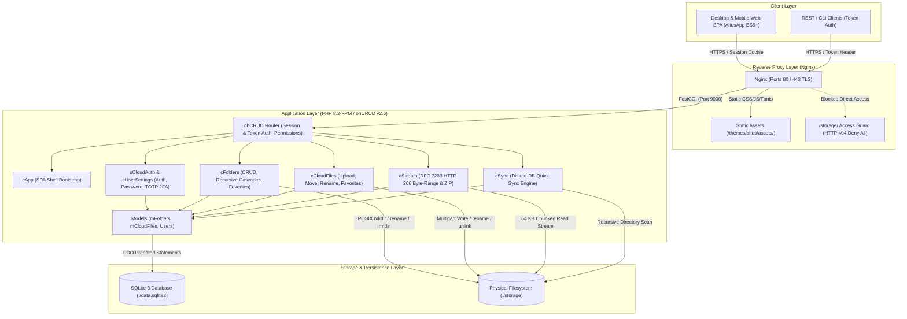
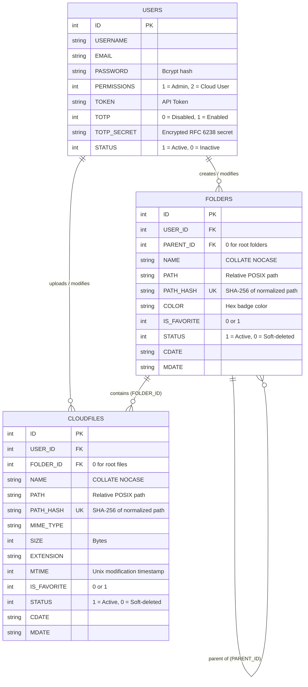
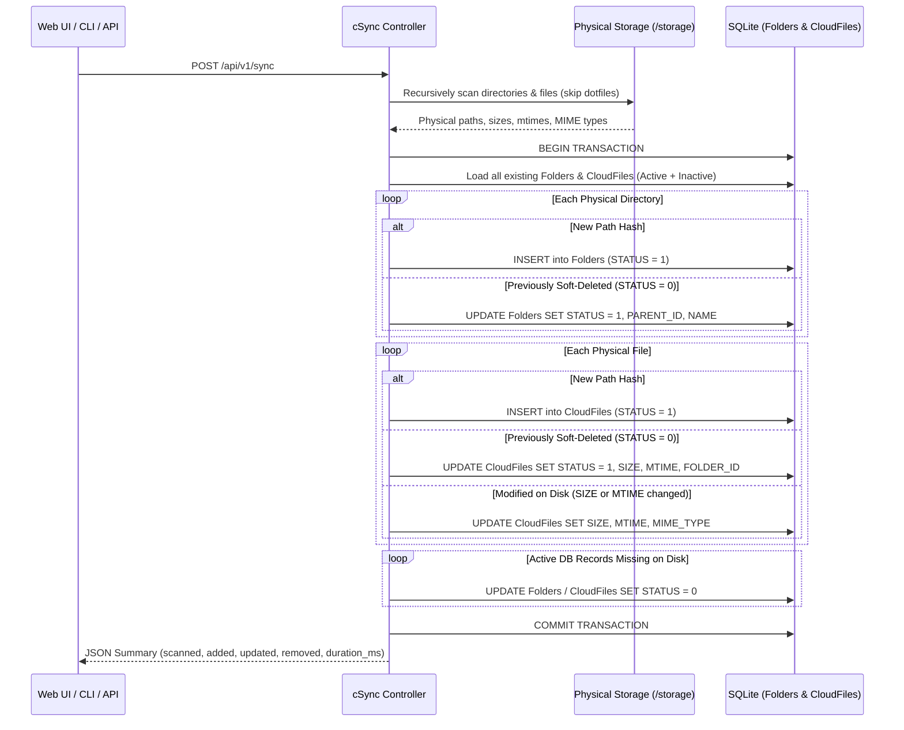
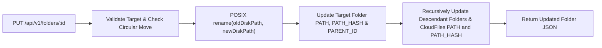
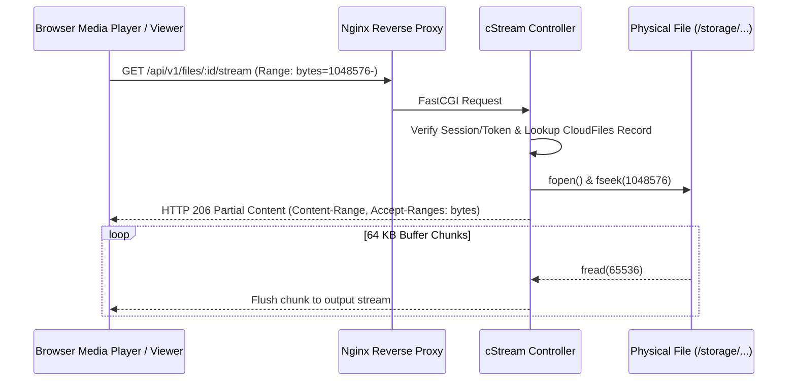

# Altus Personal Cloud — System Architecture

This document details the architectural design, request lifecycle, database schema, physical storage invariants, and synchronization flows of **Altus Personal Cloud**.

---

## 1. Core Architectural Pillars

1. **Direct Physical Filesystem Parity:** Files and directories in `./storage` (mounted to `/storage` in Docker) mirror their exact names and hierarchy on the host disk. No synthetic UUID directories or hash-obfuscated filenames exist on the filesystem.
2. **Deterministic Path Hashing (`PATH_HASH`):** Both `Folders` and `CloudFiles` store the normalized relative POSIX path (`PATH`) alongside its SHA-256 digest (`PATH_HASH`) backed by a `UNIQUE` SQLite index, enabling $O(1)$ path lookups at any folder depth.
3. **Sub-Second "Quick Sync" Engine:** Changes made directly on the host filesystem (via Finder, `rsync`, SMB, or CLI) are reconciled into SQLite inside a single atomic transaction via `cSync`.
4. **Zero Static Storage Exposure:** Nginx strictly blocks direct HTTP requests to `/storage/` (`deny all; return 404;`). All file downloads, inline previews, and media streams pass through ohCRUD authentication and `cStream`.
5. **Zero Third-Party UI Frameworks:** The Single-Page Application (SPA) is built exclusively with semantic HTML5, Vanilla CSS3 custom properties, modern Vanilla ES6+ JavaScript, and self-hosted Google Material Symbols.

---

## 2. High-Level System Topology

---

## 3. Database Schema & Entity Relationships

Altus uses SQLite 3 (`./data.sqlite3`) in Write-Ahead Logging (WAL) compatible mode. All cloud accounts share the global physical `/storage` hierarchy, indexed by `PATH_HASH` (`sha256(strtolower(PATH))`).

---

## 4. Key Operational Workflows

### 4.1 Disk-to-Database Synchronization ("Quick Sync")

When files or directories are added, modified, or removed directly inside `./storage` on the host machine, `POST /api/v1/sync` (`cSync`) reconciles the filesystem with SQLite in a single database transaction:

### 4.2 Recursive Folder Move & Rename Cascading

Because physical paths mirror database records, renaming or moving a folder cascades across both the filesystem and all descendant records in SQLite:

### 4.3 RFC 7233 HTTP 206 Byte-Range Media Streaming

To support instant video/audio scrubbing without exhausting PHP memory limits, `cStream` implements chunked byte-range responses:

---

## 5. Frontend SPA Architecture (`AltusApp`)

The frontend resides in `public/themes/altus/` and runs as a zero-dependency Single-Page Application:

- **HTML Shell (`public/themes/altus/index.html`):** Semantic layout containing the desktop sidebar, mobile off-canvas drawer, breadcrumb header, grid/list viewport container, context menus, action modals, and media theater previewer.
- **Theme Engine (`public/themes/altus/assets/css/altus.css`):** Tokenized design system using CSS custom properties under `:root` (Light Mode) and `[data-theme="dark"]` (Dark Mode), paired with an inline `<head>` script for FOUC-free startup.
- **State & View Controller (`public/themes/altus/assets/js/altus.js`):**
  - Manages active folder navigation (`currentFolderId`), breadcrumb stack, view mode (`grid` vs `list`), sort state (`name_asc`, `mtime_desc`, `size_desc`, etc.), and active filters (`favorites`, `search`).
  - Handles sequential/parallel multipart file uploads with live progress bars and collision resolution modals.
  - Orchestrates the media theater previewer with keyboard navigation (`Esc`, `ArrowLeft`, `ArrowRight`) and pan/zoom image inspection.
