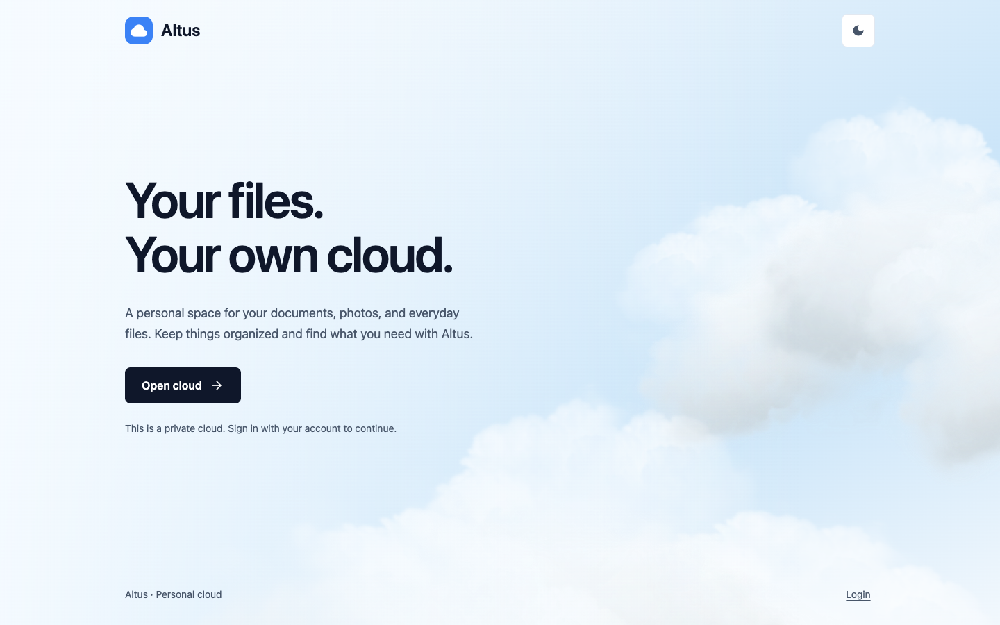

# Altus Personal Cloud

Altus stores your files on your own computer or server. Upload, organize, search,
and preview files in a browser, with private downloads and two-factor sign-in.
Your files keep their names and folders in `storage/`.



Choose **Docker for local development** or **Ubuntu for a server**. Run commands
in a terminal on the machine you are setting up, from the checkout folder unless
stated otherwise. Do not run both setups against the same database.

## Local development with Docker

You need Git, OpenSSL, Docker with Compose, and [mkcert](https://github.com/FiloSottile/mkcert)
for a locally trusted HTTPS certificate. Start Docker before continuing.

1. Clone the project, then enter it:

   ```bash
   git clone https://github.com/fellowgeek/altus.git
   cd altus
   ```

2. For a **new installation**, prepare configuration and an empty database:

   ```bash
   cp public/settings.docker.sample.php public/settings.php
   touch data.sqlite3
   mkdir -p storage logs
   openssl rand -hex 16
   ```

   Open `public/settings.php` in your editor. Replace `CHANGE_ME_WITH_SETUP` with
   the 32 characters printed by the last command. Keep this secret with your
   database. For existing data, retain its matching settings and secret instead
   of copying the sample. Do not use native Ubuntu settings with Docker.

3. Create local certificates and start the app:

   ```bash
   mkcert -install
   mkcert -cert-file private/cert.pem -key-file private/key.pem localhost altus.test 127.0.0.1 ::1
   docker compose run --rm composer_installation
   docker compose up -d web php
   ```

   Ports 80 and 443 must be free. Keep this development setup on your own machine;
   it enables automatic schema creation and uses known initial passwords.

4. Open [https://localhost/cloud/](https://localhost/cloud/). A fresh development
   database creates **`user` / `user`** for cloud access and **`admin` / `admin`**
   for administration. Change both passwords after signing in. Existing databases
   retain their current passwords. Use `docker compose down` to stop the app;
   files and the database remain on disk.

## Ubuntu server installation

You need an Ubuntu server, SSH access, a sudo-capable account, Git, and an HTTPS
hostname with a trusted certificate or HTTPS proxy. Use a checkout owned by your
normal deployment account. The installer configures PHP and dependencies; you
configure Nginx and HTTPS separately.

1. In your **server's SSH terminal**, choose a parent folder for the checkout:

   ```bash
   sudo apt-get update
   sudo apt-get install -y git
   git clone https://github.com/fellowgeek/altus.git
   cd altus
   ```

2. Run the command for your Ubuntu version:

   ```bash
   # Ubuntu 26.04: distribution PHP packages
   sudo ./setup.sh --php-version 8.5
   ```

   ```bash
   # Ubuntu 24.04: explicitly opt into the third-party PHP package repository
   sudo ./setup.sh --php-version 8.4 --add-php-ppa
   ```

   Setup creates `public/settings.php`, `var/data.sqlite3`, and the `altus`
   service account. It restarts the selected PHP-FPM service, including any other
   pools using it. It leaves Nginx, certificates, and firewall rules alone.
   Root-owned deployments show a warning and require typing **yes**.

3. Save the generated **`user`** and **`admin`** passwords shown when setup
   finishes. A root-only copy remains in `var/initial-credentials.txt`:

   ```bash
   sudo cat var/initial-credentials.txt
   ```

   Rerunning setup keeps existing passwords and data; it does not reset accounts.

4. Follow the short [Nginx and HTTPS guide](docs/nginx.md), choosing direct HTTPS
   or an HTTPS proxy. It includes a Tailscale-only option and explains every
   placeholder. Then open **your configured HTTPS hostname**, choose **Open
   cloud**, and sign in as `user`. The footer **Login** link is for `admin` CMS
   administration. Change both passwords and enable two-factor authentication
   in account settings. HTTP sign-in will not work with secure session cookies.

## Existing files, backups, and safe access

- To import files, copy them into `storage/`, then click **Sync Files** in the app.
  For another disk or a Docker-to-Ubuntu move, use the [operations guide](docs/operations.md)
  before running setup. Keep the database with its original settings secret.
- Before updates, stop writes and back up the database, `public/settings.php`,
  `storage/`, and CMS uploads in `public/global/files/`. Keep an off-server copy.
  See [backup and update steps](docs/operations.md).
- Only `public/` belongs under the web root. Keep direct storage and source access
  blocked; downloads and previews must go through authenticated application routes.
  Prefer private network access and keep application sign-in enabled.

For troubleshooting, see [operations](docs/operations.md). API and test commands
live in the [development reference](docs/development.md); implementation details
are in [ARCHITECTURE.md](ARCHITECTURE.md).

Licensed under the [MIT License](LICENSE).
