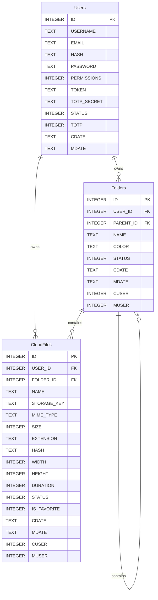

# Product Requirements Document (PRD): Altus Personal Cloud

**Document Version:** 1.0.0  
**Project:** Altus Personal Cloud  
**Base Framework:** ohCRUD PHP Microframework (v2.6)  
**Database Engine:** SQLite 3  
**Target Environment:** Docker (Nginx, PHP-FPM, SQLite), macOS / Linux  
**Status:** Approved for Implementation  

---

## 1. Executive Summary & Vision

### 1.1 Overview
**Altus** is a lightweight, high-performance, single-user personal cloud storage platform designed to manage files and folders with zero framework bloat. Drawing functional inspiration from Google Drive and Nextcloud, Altus prioritizes instantaneous load times, minimal resource consumption, strict access control, and a clean, responsive user experience without relying on third-party frontend frameworks.

### 1.2 Core Philosophy
- **Speed & Simplicity:** Minimal footprint, sub-100ms response times for metadata queries, and efficient I/O streaming.
- **Strict Data Isolation:** Files are stored securely on the filesystem and are never directly accessible via public HTTP URIs without passing through ohCRUD authentication and permission enforcement.
- **Headless & Client Ready:** Complete decoupling of business logic into a RESTful API layer, enabling web, mobile (iOS/Android), and CLI clients to interact with identical capabilities.
- **Vanilla Modernity:** Pure modern CSS and Vanilla JavaScript utilizing native browser APIs, with zero external UI dependencies (e.g., no React, Vue, Tailwind, or Bootstrap).

---

## 2. System Architecture & Tech Stack

```
+-------------------------------------------------------------------------+
|                              Clients                                    |
|   Desktop Browser  |  Mobile Browser  |  Future Mobile/Desktop Apps    |
+--------------------+------------------+--------------------------------+
                                    |
                            HTTPS / TLS 1.3
                                    |
+-------------------------------------------------------------------------+
|                         Nginx Reverse Proxy                             |
|  - SSL Termination (Port 443)                                           |
|  - Static Asset Delivery (/themes, /global with immutable caching)      |
|  - Protected Route Forwarding to PHP-FPM (unix socket / port 9000)      |
|  - Storage Directory Protected (Direct web access DENIED)               |
+-------------------------------------------------------------------------+
                                    |
                            FastCGI (PHP 8.2)
                                    |
+-------------------------------------------------------------------------+
|                        ohCRUD Framework Core                            |
|  +-------------------------------------------------------------------+  |
|  | Router: Session Auth (Web) & Token Auth (API), Permission Checks   |  |
|  +-------------------------------------------------------------------+  |
|  | Controllers:                                                      |  |
|  |  - cAuth (Login, Logout, TOTP, Password)                          |  |
|  |  - cFolders (CRUD, Color Palette, Hierarchy)                      |  |
|  |  - cCloudFiles (Upload, Metadata, Delete, Rename, Move)           |  |
|  |  - cStream (Byte-range audio/video, inline preview, downloads)     |  |
|  |  - cCloudView (Single-page app shell rendering)                   |  |
|  +-------------------------------------------------------------------+  |
|  | Models: mFolders, mCloudFiles, Users (ohCRUD core)                |  |
+-------------------------------------------------------------------------+
            |                                               |
     PDO SQLite Queries                              POSIX File I/O
            v                                               v
+-----------------------+                       +-----------------------+
|  SQLite Database      |                       |  Host File Storage    |
|  (/data/data.db)      |                       |  (/storage / symlink) |
|  - Users              |                       |  - Raw Binary Files   |
|  - Folders            |                       |  - Zero Public HTTP   |
|  - CloudFiles         |                       |  - Range/Chunk Stream |
+-----------------------+                       +-----------------------+
```

### 2.1 Technology Stack Details

| Component | Specification | Rationale |
| :--- | :--- | :--- |
| **Backend Language** | PHP 8.2+ | Modern PHP features (typed properties, match expressions, native fibers). |
| **Framework** | ohCRUD PHP Microframework | Built-in authentication, DB abstraction, CSRF protection, and zero runtime bloat. |
| **Database** | SQLite 3 via PDO | Single-file embedded storage (`data.db`), zero daemon overhead, fast concurrent reads with WAL mode. |
| **Web Server** | Nginx (Alpine) | SSL termination, HTTP/2, gzip compression, and secure reverse proxying. |
| **Iconography** | Material Symbols / Material Icons | Consistent, recognizable, and modern UI icon set without third-party frameworks. |
| **Frontend Architecture** | Semantic HTML5, Vanilla CSS3, Vanilla ES6+ | Native DOM APIs, CSS Grid/Flexbox, CSS Variables, sub-50KB bundle footprint. |

---

## 3. Database Architecture & Data Models

### 3.1 Entity Relationship Diagram



### 3.2 Table Schema Definitions

#### 3.2.1 `Users` (Existing ohCRUD Core Table)
Altus utilizes ohCRUD's built-in `Users` table with permission role differentiation:
- **Permission Level 1 (Admin):** Full framework administration (`/ohcrud/admin/`), database tooling, server metrics, and logs.
- **Permission Level 2 (Cloud User):** Access restricted exclusively to Altus cloud file storage, personal file operations, and profile security settings.

#### 3.2.2 `Folders` Table
```sql
CREATE TABLE IF NOT EXISTS `Folders` (
    `ID` INTEGER NOT NULL PRIMARY KEY AUTOINCREMENT UNIQUE,
    `USER_ID` INTEGER NOT NULL,
    `PARENT_ID` INTEGER DEFAULT 0,
    `NAME` TEXT NOT NULL,
    `COLOR` TEXT DEFAULT '#5f6368',
    `STATUS` INTEGER DEFAULT 1,
    `CDATE` TEXT,
    `MDATE` TEXT,
    `CUSER` INTEGER,
    `MUSER` INTEGER
);

CREATE INDEX IF NOT EXISTS idx_Folders_USER ON Folders (`USER_ID`);
CREATE INDEX IF NOT EXISTS idx_Folders_PARENT ON Folders (`PARENT_ID`);
CREATE INDEX IF NOT EXISTS idx_Folders_STATUS ON Folders (`STATUS`);
```

#### 3.2.3 `CloudFiles` Table
```sql
CREATE TABLE IF NOT EXISTS `CloudFiles` (
    `ID` INTEGER NOT NULL PRIMARY KEY AUTOINCREMENT UNIQUE,
    `USER_ID` INTEGER NOT NULL,
    `FOLDER_ID` INTEGER DEFAULT 0,
    `NAME` TEXT NOT NULL,
    `STORAGE_KEY` TEXT NOT NULL UNIQUE,
    `MIME_TYPE` TEXT NOT NULL,
    `SIZE` INTEGER NOT NULL,
    `EXTENSION` TEXT NOT NULL,
    `HASH` TEXT,
    `WIDTH` INTEGER DEFAULT NULL,
    `HEIGHT` INTEGER DEFAULT NULL,
    `DURATION` INTEGER DEFAULT NULL,
    `STATUS` INTEGER DEFAULT 1,
    `IS_FAVORITE` INTEGER DEFAULT 0,
    `CDATE` TEXT,
    `MDATE` TEXT,
    `CUSER` INTEGER,
    `MUSER` INTEGER
);

CREATE INDEX IF NOT EXISTS idx_CloudFiles_USER ON CloudFiles (`USER_ID`);
CREATE INDEX IF NOT EXISTS idx_CloudFiles_FOLDER ON CloudFiles (`FOLDER_ID`);
CREATE INDEX IF NOT EXISTS idx_CloudFiles_STORAGE_KEY ON CloudFiles (`STORAGE_KEY`);
CREATE INDEX IF NOT EXISTS idx_CloudFiles_STATUS ON CloudFiles (`STATUS`);
CREATE INDEX IF NOT EXISTS idx_CloudFiles_MIME ON CloudFiles (`MIME_TYPE`);
```

---

## 4. Storage Architecture & Security Engine

### 4.1 Physical File Storage Strategy
1. **Designated Storage Root:**
   - On Host: `./storage`
   - In Container: `/storage` (mounted as a Docker volume in `docker-compose.yml`)
   - Symlink in Project: `public/storage` pointing to `/storage` **OR** keeping `/storage` strictly outside the web root.
2. **Access Protection:**
   - The storage directory is **strictly prohibited** from direct web access. If symlinked into `public`, Nginx configuration will enforce:
     ```nginx
     location ^~ /storage/ {
         deny all;
         return 404;
     }
     ```
   - All file access is brokered through an authenticated PHP endpoint: `cStream::serve()`.
3. **Physical Naming & Partitioning:**
   - Stored files do not use raw client filenames on disk to eliminate path traversal, filesystem encoding bugs, and filename collision risks.
   - Files are stored using a deterministic storage key:
     `STORAGE_KEY = sha256(USER_ID . microtime(true) . random_bytes(16)) . '.' . EXTENSION`
   - Disk partitioning: `/storage/files/{year}/{month}/{STORAGE_KEY}` to ensure directories remain within optimal OS inode limits.
   - Original filenames, display names, and folder hierarchies are managed strictly in the SQLite database.

### 4.2 Streaming & Range Request Engine (HTTP 206)
To support seamless audio/video seeking and resumable downloads, the streaming controller implements full HTTP Range header compliance (`RFC 7233`):
- Handles `Range: bytes=start-end` requests.
- Returns `HTTP/2 206 Partial Content` with `Content-Range: bytes start-end/total_size`.
- Employs 64KB chunked buffer streaming via `fopen()`, `fseek()`, and `fpassthru()` / `fread()` to prevent PHP memory exhaustion on multi-gigabyte media files.
- Sets appropriate caching headers (`Cache-Control: private, no-transform, max-age=86400`) and security headers (`X-Content-Type-Options: nosniff`).

---

## 5. Functional Specifications

### 5.1 Authentication & Session Management
- **Web App Auth:** Standard session cookie managed by ohCRUD (`__OHCRUD_SESSION_LIFETIME__ = 86400` with `Secure`, `HttpOnly`, `SameSite=Lax`).
- **Permission Boundary:**
  - Altus Cloud operations require `PERMISSIONS <= 2`.
  - Admin operations require `PERMISSIONS = 1`.
- **User Profile UI:**
  - Password change with bcrypt hashing verification.
  - TOTP enrollment: displays OTP Auth URI QR code (rendered via lightweight inline SVG) and 16-character manual secret.
  - TOTP activation verification requirement before enabling.
  - Ability to disable TOTP (requires current password verification).

### 5.2 File & Folder Browser
- **Hierarchical Navigation:**
  - Dynamic breadcrumb navigation trail (`Home / Documents / Projects / 2026`).
  - Instant navigation into child folders.
  - "Up one level" navigation.
- **View Modes:**
  - **Grid View:** Visual card layout displaying high-resolution icon/thumbnail, file name, size, and quick action trigger.
  - **List View:** Compact data table displaying item icon, name, modification date, file type, file size, and action buttons.
  - Persistent user view mode preference (stored in `localStorage`).
- **Sorting & Filtering:**
  - Sort by: Name (A-Z, Z-A), Date Modified (Newest, Oldest), Size (Largest, Smallest).
  - Quick filter chips: All, Images, Documents, Audio, Video, Archives.
  - Instant client-side text search with debounced server-side deep search fallback.
- **Folder Customization:**
  - Color palette selection (Presets: Classic Slate, Blue, Emerald, Crimson, Amber, Purple, Teal, Coral).
  - Visual folder badge matching chosen color in both grid and list views.

### 5.3 File Operations
- **Upload Engine:**
  - Drag-and-drop zone over entire browser window and explicit upload button.
  - Multi-file batch upload queue with progress bar and speed indicator.
  - Client-side size and MIME validation before upload.
  - Direct multipart stream ingestion to temp file, then committed to `/storage/` and indexed in `CloudFiles`.
- **Download:**
  - Single file download with `Content-Disposition: attachment; filename="<original_name>"`.
  - Direct binary stream with accurate `Content-Length`.
- **Delete:**
  - Soft delete (flagged `STATUS = 0`) with immediate undo toast.
  - Permanent delete option / Trash purge.
- **Move & Rename:**
  - Modal dialog to rename files/folders with real-time name conflict checks.
  - Move dialog allowing folder tree selection for moving files and folders.

### 5.4 File Preview System
Modal overlay with backdrop blur, keyboard shortcuts (`Esc` to close, `Left`/`Right` arrows for next/prev file in folder):
- **Images (`jpg`, `jpeg`, `png`, `webp`, `gif`, `svg`):**
  - High-res responsive rendering with pan and zoom capabilities.
- **PDF Documents (`pdf`):**
  - Native browser PDF rendering via embedded `<object data="..." type="application/pdf">` with fullscreen toggle.
- **Audio Files (`mp3`, `wav`, `ogg`, `m4a`, `flac`):**
  - Integrated custom player: scrub bar, play/pause, volume, duration tracker, and looping.
- **Video Files (`mp4`, `webm`, `mov`):**
  - HTML5 video player with seekable byte-range streaming, fullscreen, picture-in-picture, and playback speed controls.
- **Code & Text Files (`txt`, `md`, `json`, `csv`, `log`, `xml`):**
  - Monospace scrollable viewer with line numbers and copy-to-clipboard button.

---

## 6. RESTful API Specifications

All API endpoints return standard JSON responses following ohCRUD convention:
```json
{
  "data": {},
  "errors": [],
  "success": true
}
```

### 6.1 Authentication Endpoints
- `POST /api/v1/auth/login`
  - Payload: `{ "USERNAME": "user", "PASSWORD": "password" }`
  - Response: `{ "loggedIn": true, "TOTP": 0|1, "TOTPVerified": true|false }`
- `POST /api/v1/auth/verify`
  - Payload: `{ "TOTP": "123456" }`
  - Response: `{ "loggedIn": true, "TOTPVerified": true }`
- `POST /api/v1/auth/logout`
  - Destroys active session.
- `GET /api/v1/auth/me`
  - Returns current user profile (ID, USERNAME, EMAIL, PERMISSIONS, TOTP status).

### 6.2 Folder Endpoints
- `GET /api/v1/folders?parent_id=0`
  - Query parameters: `parent_id` (integer)
  - Returns array of child folders and breadcrumb path.
- `POST /api/v1/folders`
  - Payload: `{ "NAME": "Invoices", "PARENT_ID": 0, "COLOR": "#4285F4" }`
  - Returns created folder object.
- `PUT /api/v1/folders/:id`
  - Payload: `{ "NAME": "2026 Invoices", "PARENT_ID": 2, "COLOR": "#34A853" }`
  - Returns updated folder object.
- `DELETE /api/v1/folders/:id`
  - Deletes folder and flags child items.

### 6.3 File Endpoints
- `GET /api/v1/files?folder_id=0&sort=name&order=asc&filter=all&search=`
  - Returns list of files matching folder and filters.
- `POST /api/v1/files/upload`
  - Multipart form data: `folder_id` (integer), `file` (binary blob).
  - Returns created file record.
- `PUT /api/v1/files/:id`
  - Payload: `{ "NAME": "Report_Final.pdf", "FOLDER_ID": 3 }`
  - Updates file metadata or moves file.
- `DELETE /api/v1/files/:id`
  - Soft-deletes or removes file record and associated binary file.
- `GET /api/v1/files/:id/metadata`
  - Returns detailed file metadata (dimensions, duration, size, dates, checksum).

### 6.4 Streaming & Content Endpoints
- `GET /api/v1/files/:id/stream`
  - Streams file inline with byte-range support.
- `GET /api/v1/files/:id/download`
  - Forces file download with `Content-Disposition: attachment`.
- `GET /api/v1/files/:id/thumbnail`
  - Returns lightweight image thumbnail.

### 6.5 User Settings Endpoints
- `POST /api/v1/user/password`
  - Payload: `{ "CURRENT_PASSWORD": "...", "NEW_PASSWORD": "..." }`
- `POST /api/v1/user/totp/setup`
  - Generates TOTP secret and returns provisioning URI.
- `POST /api/v1/user/totp/enable`
  - Payload: `{ "CODE": "123456" }`
- `POST /api/v1/user/totp/disable`
  - Payload: `{ "PASSWORD": "..." }`

---

## 7. Frontend Design System & UI Specifications

### 7.1 Visual Aesthetic & Design Tokens
Altus adheres to a clean, modern aesthetic with high visual contrast, deliberate typography, and subtle micro-interactions.

```css
:root {
  /* Surface & Background Colors */
  --bg-app: #f8fafc;
  --bg-surface: #ffffff;
  --bg-surface-elevated: #ffffff;
  --bg-hover: #f1f5f9;
  --bg-active: #e2e8f0;
  
  /* Text & Contrast */
  --text-primary: #0f172a;
  --text-secondary: #475569;
  --text-muted: #94a3b8;
  --border-subtle: #e2e8f0;
  --border-strong: #cbd5e1;

  /* Accent Colors */
  --accent-primary: #2563eb;
  --accent-primary-hover: #1d4ed8;
  --accent-focus-ring: rgba(37, 99, 235, 0.25);
  --danger: #ef4444;
  --danger-hover: #dc2626;

  /* Folder Color Palette */
  --folder-slate: #64748b;
  --folder-blue: #3b82f6;
  --folder-green: #10b981;
  --folder-red: #ef4444;
  --folder-amber: #f59e0b;
  --folder-purple: #8b5cf6;
  --folder-teal: #14b8a6;
  --folder-pink: #ec4899;

  /* Elevation Shadows */
  --shadow-sm: 0 1px 2px 0 rgba(0, 0, 0, 0.05);
  --shadow-md: 0 4px 6px -1px rgba(0, 0, 0, 0.1), 0 2px 4px -2px rgba(0, 0, 0, 0.1);
  --shadow-lg: 0 10px 15px -3px rgba(0, 0, 0, 0.1), 0 4px 6px -4px rgba(0, 0, 0, 0.1);
  --shadow-modal: 0 25px 50px -12px rgba(0, 0, 0, 0.25);

  /* Layout Constants */
  --sidebar-width: 256px;
  --header-height: 64px;
  --radius-sm: 6px;
  --radius-md: 10px;
  --radius-lg: 16px;
}
```

### 7.2 Responsive Layout Structure
- **Desktop (>= 1024px):**
  - Fixed left sidebar navigation (Storage breakdown, All Files, Starred, Trash, Account Settings).
  - Main top bar with instant search input, upload action button, view switcher (Grid/List), and user avatar menu.
  - Main content pane with breadcrumbs, action toolbar, folders section, and files section.
- **Tablet (768px - 1023px):**
  - Collapsible sidebar toggleable via hamburger menu icon.
  - Multi-column grid adapts to 3 columns.
- **Mobile (< 768px):**
  - Full-screen fluid canvas.
  - Off-canvas slide-out navigation drawer.
  - Floating Action Button (FAB) for fast upload / create folder actions.
  - Bottom sheet for item context menus (Rename, Color, Delete, Download).
  - Minimum touch target size: 48px x 48px.

### 7.3 Iconography Integration
- Assets rely on Material Symbols / Material Icons web font or inline SVGs.
- File type icon mapping:
  - Folders: `folder`, `folder_open`
  - Images: `image`
  - PDFs: `picture_as_pdf`
  - Audio: `audio_file` / `music_note`
  - Video: `video_file` / `movie`
  - Code/Text: `description` / `code`
  - Archives: `folder_zip`
  - Generic: `insert_drive_file`

---

## 8. Implementation Roadmap & Task Breakdown

### Phase 1: Storage Infrastructure & Framework Configuration
- [ ] **Task 1.1:** Configure storage directory structure on host (`/storage` or `./storage`) and update `docker-compose.yml` to mount host storage to `/storage` in PHP container.
- [ ] **Task 1.2:** Update `private/nginx.conf` to explicitly deny static HTTP direct access to storage paths, ensuring all reads traverse PHP authentication.
- [ ] **Task 1.3:** Increase PHP-FPM upload and memory limits in `private/PHP-Custom.ini` (`upload_max_filesize = 500M`, `post_max_size = 500M`, `memory_limit = 256M`).
- [ ] **Task 1.4:** Update `public/routes.php` with Altus endpoints (`/api/v1/auth/`, `/api/v1/folders/`, `/api/v1/files/`, `/api/v1/user/`, `/cloud/`).

### Phase 2: Database Schema & User Seeding
- [ ] **Task 2.1:** Create `mFolders.php` model with automatic SQLite table creation and indexes (`Folders`).
- [ ] **Task 2.2:** Create `mCloudFiles.php` model with automatic SQLite table creation and indexes (`CloudFiles`).
- [ ] **Task 2.3:** Implement database migration/seeding script to create a dedicated Cloud User (`USERNAME = user`, `PERMISSIONS = 2`, `STATUS = 1`) alongside existing `admin` (`PERMISSIONS = 1`).

### Phase 3: Core API Controllers & File Streaming Engine
- [ ] **Task 3.1:** Implement `cCloudAuth.php` controller to handle login, session renewal, logout, and permission checks.
- [ ] **Task 3.2:** Implement `cUserSettings.php` controller for password changes and TOTP enrollment/verification.
- [ ] **Task 3.3:** Implement `cFolders.php` controller for folder CRUD operations, parent hierarchy validation, and color tagging.
- [ ] **Task 3.4:** Implement `cCloudFiles.php` controller for file metadata queries, renaming, moving, and deletion.
- [ ] **Task 3.5:** Implement `cUpload.php` controller with multipart ingestion, MIME verification, file hashing, and atomic filesystem persistence.
- [ ] **Task 3.6:** Implement `cStream.php` controller with HTTP 206 Partial Content byte-range streaming, inline preview delivery, and attachment download headers.

### Phase 4: UI Shell, File Browser & View Engine
- [ ] **Task 4.1:** Build responsive Altus layout template in `public/themes/altus/` or standalone view shell.
- [ ] **Task 4.2:** Integrate Material Icons font/assets into local project assets.
- [ ] **Task 4.3:** Build vanilla CSS design system (`altus.css`) with CSS custom properties, grid/flex layouts, animations, and dark/light system variables.
- [ ] **Task 4.4:** Build Vanilla JS state management core (`altus.js`) handling active folder, view mode (grid/list), sorting, search, and selection.
- [ ] **Task 4.5:** Implement dynamic folder rendering with custom color badges.
- [ ] **Task 4.6:** Implement file list and grid view renderers with file metadata formatting (bytes to KB/MB/GB, timestamps).

### Phase 5: File Operations & Interactions
- [ ] **Task 5.1:** Implement Drag & Drop file uploader with visual drag overlay and multi-file progress queue.
- [ ] **Task 5.2:** Build folder creation and folder color-picker dialog.
- [ ] **Task 5.3:** Build file and folder rename modal with inline validation.
- [ ] **Task 5.4:** Build move dialog with folder hierarchy tree selection.
- [ ] **Task 5.5:** Implement deletion flow with confirmation and toast notification.
- [ ] **Task 5.6:** Implement single and batch download handling.

### Phase 6: Media Preview System
- [ ] **Task 6.1:** Build accessible modal preview container with backdrop and keyboard listeners (`Esc`, arrows).
- [ ] **Task 6.2:** Implement image previewer with zoom and pan controls.
- [ ] **Task 6.3:** Implement PDF viewer utilizing native browser document embed.
- [ ] **Task 6.4:** Implement custom audio player with playback controls and scrub bar.
- [ ] **Task 6.5:** Implement HTML5 video player connected to the byte-range streaming endpoint.
- [ ] **Task 6.6:** Implement text and code previewer with line numbers.

### Phase 7: Account Settings, Security & Polish
- [ ] **Task 7.1:** Build user settings view: password change form and TOTP setup wizard with QR code generation.
- [ ] **Task 7.2:** Audit all endpoints for permission enforcement (`PERMISSIONS <= 2`) and path traversal protection.
- [ ] **Task 7.3:** Verify mobile viewports across iOS Safari and Android Chrome simulations.
- [ ] **Task 7.4:** Perform end-to-end testing of 500MB+ file uploads and video range seeking.

---

## 9. Verification & Acceptance Criteria
1. **Security:** An unauthenticated `GET` request to any file endpoint or physical storage path yields `HTTP 401 Unauthorized` or `404 Not Found`.
2. **Role Isolation:** A Cloud User (`PERMISSIONS = 2`) cannot access `/ohcrud/admin/` or administrative DB methods (receives `HTTP 403 Forbidden`).
3. **Performance:** Folder navigation and listing render in under 150ms over local HTTPS.
4. **Media Playback:** A 100MB+ MP4 video streams immediately and allows instantaneous seeking to arbitrary timestamps without buffering entire file.
5. **Zero Framework Bloat:** Total client-side JavaScript and CSS bundle remains under 60KB uncompressed, excluding icons.
